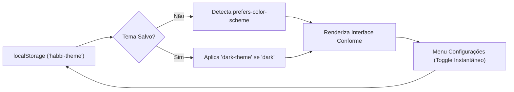

# Habbi Design System
**Documentação Oficial de Identidade Visual, Interface e Componentes**  
*Curso de Desenho Industrial — Universidade Federal de Santa Maria (UFSM)*  
*Disciplina: Laboratório de Interfaces | Versão do Aplicativo: 2.0 (Mobile Web App)*  

---

## Sumário
1. [Visão Geral & Conceito do Habbi](#1-visão-geral--conceito-do-habbi)
2. [A Mascote Morgana & Linguagem das Ilustrações](#2-a-mascote-morgana--linguagem-das-ilustrações)
3. [Paleta de Cores Real & Tokens Semânticos](#3-paleta-de-cores-real--tokens-semânticos)
4. [Tipografia & Hierarquia de Escala](#4-tipografia--hierarquia-de-escala)
5. [Espaçamentos, Formas e Proporções](#5-espaçamentos-formas-e-proporções)
6. [Catálogo de Componentes de Interface](#6-catálogo-de-componentes-de-interface)
7. [Arquitetura dos Temas: Claro & Escuro](#7-arquitetura-dos-temas-claro--escuro)
8. [Sistema de Ilustrações, Avatares e Ícones](#8-sistema-de-ilustrações-avatares-e-ícones)
9. [Diretrizes de Responsividade & Acessibilidade (WCAG 2.2 AA)](#9-diretrizes-de-responsividade--acessibilidade-wcag-22-aa)
10. [Exemplos de Aplicação & Boas Práticas](#10-exemplos-de-aplicação--boas-práticas)
11. [Mapeamento de Inconsistências Técnicas do Projeto](#11-mapeamento-de-inconsistências-técnicas-do-projeto)

---

## 1. Visão Geral & Conceito do Habbi

### 1.1. Contexto Acadêmico e Proposta
O **Habbi** é um produto digital concebido no âmbito acadêmico do curso de **Desenho Industrial da Universidade Federal de Santa Maria (UFSM)**, na disciplina de *Laboratório de Interfaces*. 

A proposta nasceu da necessidade de transformar a experiência de cessação de hábitos nocivos — com foco inicial na **redução do tabagismo** — em uma jornada leve, empática e acolhedora. Enquanto os aplicativos tradicionais de cessação costumam adotar uma abordagem médica, fria, punitiva ou baseada no medo e na culpa (com ênfase em cronômetros que "zeram" bruscamente e mensagens alarmistas), o Habbi introduz o paradigma da **Intervenção Comportamental Instantânea Afetiva**:
- **Design Acolhedor (*Cozy Interface*):** A interface funciona como um espaço de refúgio e suporte emocional, e não como uma ferramenta de vigilância estressante.
- **Micro-intervenções Imediatas (SOS):** Em momentos agudos de fissura (*craving*), o aplicativo oferece suporte prático em menos de 3 minutos por meio de respiração guiada (4-6), técnica de ancoragem multissensorial (*Grounding 5-4-3-2-1*), incentivo à hidratação e minijogos de foco cognitivo.
- **Valorização das Micro-vitórias:** Cada cigarro evitado, cada momento de fissura superado e cada economia acumulada são celebrados de forma tangível.
- **Arquitetura Escalável de Jornadas:** Embora o módulo atual atenda o tabagismo, a taxonomia de telas e componentes foi estruturada para incorporar futuras jornadas: *Vape*, *Álcool*, *Apostas*, *Redes Sociais* e *Procrastinação*.

### 1.2. Princípios Estéticos: Linguagem Visual Flat Autoral
A linguagem gráfica e interativa do Habbi fundamenta-se em princípios de clareza, afeto e funcionalidade desenvolvidos especialmente para a identidade do projeto:
- **Cores Sólidas e Planas (*Solid Flat Colors*):** Rejeição categórica de gradientes fotográficos, sombras pesadas ou texturas artificiais.
- **Blocos de Cor Pura:** Uso de cartões e palcos com cores vibrantes e contrastantes que organizam a hierarquia visual.
- **Cantos Generosamente Arredondados:** Curvaturas orgânicas e suaves (`border-radius` variando de 14px a 28px e 999px em pílulas), que transmitem gentileza, modernidade e conforto tátil.
- **Zero Glassmorphism e Zero Blur:** Não se utilizam desfoques de fundo (*backdrop-filter: blur*), transparências complexas de vidro ou efeitos ópticos difusos, preservando nitidez vetorial e alto contraste em qualquer dispositivo.

---

## 2. A Mascote Morgana & Linguagem das Ilustrações

```
          /\_/\
         ( o.o )   <-- "Morgana: a gatinha preta com olhos expressivos
          > ^ <         que transforma o cuidado em carinho."
```

### 2.1. A Musa Inspiradora
A identidade visual e todos os personagens do Habbi foram desenhados com base em uma personagem real: a **Morgana**, gatinha preta da designer e idealizadora do projeto. A presença de uma figura viva, afetuosa e autêntica confere ao aplicativo sua maior força de conexão com o usuário.

### 2.2. Linguagem Visual das Ilustrações Autorais
- **Estilo Gráfico:** Ilustrações autorais 2D com linhas pretas limpas, olhos expressivos verdes/luminosos e proporções infantis e carismáticas (*chibi/cute*).
- **Sem Julgamento:** A gatinha Morgana nunca repreende o usuário. Se houver um registro de cigarro ou recaída, ela expressa acolhimento, prontidão para recomeçar ou aconchego, eliminando o estigma do erro.
- **Estados Emocionais Representados nos Assets:**
  - *Calmo / Serena (`Cabeça de Gato Preto com Olhos Verdes calmo.png`, `gato pose normal padrao.png`):* Estado de equilíbrio, presente na Home flutuando calmamente.
  - *Feliz / Celebrativa (`Cabeça de Gato Preto com Olhos Verdes feliz.png`, `gato segurando coração.png`):* Recompensa ao bater metas diárias ou registrar dias limpos.
  - *Ansiosa / Em Alerta (`Gato Preto Ansioso com Gotas Azuis.png`):* Empatia visual ao usuário durante momentos de ansiedade ou alta vontade relatada.
  - *Reflexiva / Dúvida (`gato com ponto de nterrogação.png`, `gato_identifique_cropped.png`):* Apoio na identificação de gatilhos e padrões de comportamento.
  - *Aconchegada / Descanso (`gato dormindo.png`, `gato na caixa.png`, `gato escondido arbusto.png`):* Representação de momentos de descompressão e calma.
  - *Interativa / Tátil (`pata pra cima.png`, `pata pra baixo.png`, `patinha_icon.png`):* Elementos de gamificação onde a pata da gatinha reage diretamente ao toque do usuário.

### 2.3. Processamento Dinâmico de Transparência via Canvas
Para que as ilustrações autorais pudessem interagir fluidamente sobre palcos e cartões de qualquer cor sólida sem requerer reexportação manual de dezenas de arquivos, o Habbi emprega um algoritmo dinâmico em JavaScript (`app.js`):
```javascript
// O canvas lê a imagem original, identifica os pixels de fundo branco puro
// e converte seu canal alfa para 0 (transparente), eliminando halos e bordas duras:
const ctx = canvas.getContext('2d');
const imgData = ctx.getImageData(0, 0, width, height);
for (let i = 0; i < imgData.data.length; i += 4) {
  if (imgData.data[i] > 240 && imgData.data[i+1] > 240 && imgData.data[i+2] > 240) {
    imgData.data[i+3] = 0; // Transparência total
  }
}
```

---

## 3. Paleta de Cores Real & Tokens Semânticos

A paleta de cores do Habbi foi estruturada em variáveis CSS globais (`style.css`), balanceando cores primárias vibrantes com superfícies confortáveis. Todas as cores foram rigorosamente testadas para atender aos requisitos de contraste **WCAG 2.2 AA (mínimo de 4.5:1 para texto normal e 3.0:1 para elementos de interface)**.

### 3.1. Cores de Marca e Categorias Semânticas

| Categoria / Nome | Token CSS | HEX Oficial | Função no Habbi |
| :--- | :--- | :---: | :--- |
| **Verde Marca** (Principal) | `--primary` | `#6CCB4F` | Identidade visual, botão principal, dias sem fumar, progresso ativo |
| **Verde Escuro** | `--primary-dark` | `#2E7D32` | Texto em superfícies claras, ícones ativos, bordas de sucesso |
| **Verde Claro** | `--primary-light` | `#A8E67A` | Destaques suaves, tags secundárias de sucesso |
| **Amarelo Energia** | `--yellow` | `#FFD93D` | Palco do mascote (Home padrão), registro de vontade/fissura |
| **Amarelo Escuro** | `--yellow-dark` | `#F4C430` | Bordas e acentos de atenção |
| **Amarelo Suave** | `--yellow-light` | `#FFF3A6` | Fundo de badges de energia |
| **Azul Ferramentas** | `--blue` | `#5AB8FF` | Seção de ferramentas, foco cognitivo, hidratação |
| **Azul Profundo** | `--blue-dark` | `#339AF0` | Indicadores de foco visível (`:focus-visible`), links |
| **Azul Gelo** | `--blue-light` | `#D8F0FF` | Pílulas e cartões de apoio respiratório |
| **Laranja SOS** | `--orange` | `#FF9F43` | Intervenção de emergência SOS, botões de ação rápida |
| **Laranja Intenso** | `--orange-dark` | `#F97316` | Estado hover/active do botão SOS |
| **Laranja Pêssego** | `--orange-light` | `#FFD7B5` | Destaque suave em chips de contexto de urgência |
| **Coral / Vermelho** | `--coral` | `#FF7F7F` | Registro de consumo de cigarro, recaídas acolhidas |
| **Vermelho Alerta** | `--coral-alert` | `#DC2626` | Ações críticas destrutivas, botão de Sair da Conta |
| **Roxo Reflexão** | `--purple` | `#B388FF` | Cards de insights, registro de sentimentos e humor |
| **Roxo Escuro** | `--purple-dark` | `#8B5CF6` | Missões diárias, textos destacados em cards roxos |
| **Roxo Claro** | `--purple-light` | `#E8D9FF` | Superfície suave de cartões de autoconhecimento |
| **Rosa Doce** | (Palco Mascote) | `#FF8FB8` | Variação lúdica do palco da Home (estágio rosa) |

### 3.2. Superfícies Neutras: Tema Claro vs. Tema Escuro

| Token de Superfície | Tema Claro (`:root`) | Tema Escuro (`.dark-theme`) | Função Arquitetural |
| :--- | :---: | :---: | :--- |
| `--bg-color` | `#FAFAF7` | `#121214` | Fundo geral da tela do dispositivo |
| `--bg-color-alt` | `#F8FAF5` | `#1A1A1E` | Fundo de seções secundárias, trilhas de sliders |
| `--card-bg` | `#FFFFFF` | `#1E1E24` | Superfície principal de cartões e modais |
| `--border-color` | `#E5E7EB` | `#2D2D34` | Contorno sutil de cartões e divisores |
| `--border-color-active` | `#D1D5DB` | `#4B5563` | Borda de inputs ativos e cards interativos |
| `--text-primary` | `#111827` | `#F3F4F6` | Títulos, valores de destaque, botões principais |
| `--text-secondary` | `#4B5563` | `#9CA3AF` | Parágrafos explicativos, rótulos de navegação |
| `--text-muted` | `#526071` | `#A1A1AA` | Legendas, rodapés, dicas (WCAG AA >= 4.5:1) |
| `--coral-alert` | `#DC2626` | `#FF7F7F` | Botões de logout e alertas com alto contraste |

---

## 4. Tipografia & Hierarquia de Escala

### 4.1. Famílias Tipográficas
O Habbi prioriza tipografias humanistas arredondadas para transmitir acolhimento e amabilidade:
- **Fonte Primária & Títulos:** `'SF Pro Rounded', ui-rounded, 'SF Pro Display', -apple-system, BlinkMacSystemFont, 'Nunito', sans-serif;`
- **Fallback Primário:** Google Font `Nunito` (pesos 700, 800 e 900), garantindo a mesma textura arredondada em navegadores Windows/Android.

### 4.2. Escala Tipográfica do Projeto

| Nível / Seletor | Tamanho | Peso | Line-Height | Letter-Spacing | Exemplo de Aplicação |
| :--- | :---: | :---: | :---: | :---: | :--- |
| **Display Hero** | `64px` | 800 (Heavy) | `1.0` | `-0.04em` | Contador gigante de dias/cigarros na Home |
| **Splash / Welcome H1** | `42px` | 600 / 700 | `1.15` | `-0.02em` | Título "Olá!" na tela de Boas-vindas |
| **Numeric Value Display** | `38px` | 600 / 700 | `1.1` | `-0.02em` | Valor do slider de cigarros por dia |
| **H1 (Título de Tela)** | `32px` | 700 (Bold) | `1.2` | `-0.02em` | Títulos principais de tela ("Entenda seus hábitos") |
| **H2 (Subtítulo de Seção)**| `24px` | 700 (Bold) | `1.25` | `-0.015em`| Cabeçalhos de formulário ("Escolha sua jornada") |
| **H3 (Títulos de Cards)** | `18px` | 600 (Semibold)| `1.3` | `-0.01em` | Título no card SOS e cabeçalhos de modais |
| **Botão Principal (`.btn`)**| `18px` | 600 (Semibold)| `1.0` | normal | Textos de botões primários ("Continuar", "Começar") |
| **Parágrafo (`p`)** | `16px` | 500 / 600 | `1.55` | normal | Textos corridos de explicação e instruções |
| **Chips & Seletores** | `14px` | 600 (Semibold)| `1.2` | normal | Itens de seleção rápida ("Tabagismo", "Menos de 1") |
| **Legenda (`.caption`)** | `14px` | 500 (Medium) | `1.45` | normal | Textos de auxílio sob inputs e passos |
| **Microcopy / Navegação** | `11px` | 600 (Semibold)| `1.2` | normal | Rótulos da barra inferior (Home, Calendário, etc.) |
| **Categoria Uppercase** | `11px` | 600 (Semibold)| `1.0` | `+0.08em` | Títulos de categorias de menus e divisores |

---

## 5. Espaçamentos, Formas e Proporções

### 5.1. Raio de Borda (*Border Radius*)
As formas geométricas do Habbi são estritamente curvas e amigáveis:
- `--border-radius-lg: 20px`: Cartões de conteúdo (`.card`), painéis inferiores de modais (`.wl-goal-modal-sheet`), cards de conquistas.
- **Palco do Mascote na Home:** `28px`, delimitando a janela vibrante de animação.
- `--border-radius-md: 14px`: Botões de formulário (`.btn`), caixas de seleção (*chips*), campos de entrada (*inputs*).
- `--border-radius-sm: 8px`: Badges menores, itens de lista compactos, ícones de apoio.
- **Pílula Completa (`999px`):** Pílulas de status no topo (economia acumulada, botão de SOS da Home, badges de progresso).

### 5.2. Dimensões do Contêiner do Aplicativo
- **Largura Máxima do Simulador:** `412px` (proporção ideal para smartphones de tamanho padrão moderno).
- **Altura Máxima:** `860px` ou `100vh` em celulares reais.
- **Áreas Seguras (*Safe Area*):** Respeito nativo a `env(safe-area-inset-top)` e `env(safe-area-inset-bottom)` para evitar sobreposição por *notches* ou barras de gestos.
- **Barra de Navegação Inferior (`.bottom-nav`):** `68px` de altura fixa, posicionada no rodapé com `z-index: 100`.

### 5.3. Botões e Alvos de Toque (*Touch Targets*)
- **Botão Primário (`.btn`):** Altura padrão de `64px` (mínimo garantido de `48px`), largura de `100%`, preenchimento horizontal de `32px`.
- **Botões de Registro Rápido (`.btn-quick-choice`):** Altura de `72px`, proporcionando área de toque generosa em momentos de urgência ou agitação motora.
- **Dimensão Mínima de Acessibilidade:** Nenhum botão, link, seletor ou ícone interativo possui área de toque inferior a **44 × 44 px**.

---

## 6. Catálogo de Componentes de Interface

### 6.1. Botões (`.btn`)
Os botões do Habbi utilizam cores sólidas, tipografia clara e resposta tátil imediata:
```css
.btn {
  display: inline-flex;
  align-items: center;
  justify-content: center;
  min-height: 48px;
  height: 64px;
  padding: 0 32px;
  border-radius: var(--border-radius-md);
  font-size: 18px;
  font-weight: 600;
  cursor: pointer;
  border: none;
  box-shadow: 0 2px 5px rgba(0, 0, 0, 0.08);
}
.btn:active {
  transform: scale(0.97); /* Micro-interação física */
}
```
- **`.btn-primary`:** Fundo verde `#2E7D32` (tema claro) ou `#6CCB4F` (tema escuro), texto branco ou escuro de alto contraste.
- **`.btn-secondary`:** Fundo neutro `--card-bg`, contorno com `--border-color`, texto `--text-primary`.
- **`.btn-sos`:** Fundo laranja vibrante `--orange`, botão acolhedor e de visibilidade instantânea.
- **`.btn-quick-choice`:** Cartões de ação direta no Registro Rápido (Tela 11):
  - *Não fumei:* Verde vibrante (`#6CCB4F`) com ícone de escudo.
  - *Fumei:* Vermelho suave/coral (`#FF7F7F`) com ícone de cigarro.
  - *Humor:* Roxo reflexivo (`#B388FF`) com ícone de carinha.
  - *Vontade:* Amarelo energia (`#FFD93D`) com ícone de raio/fogo.

### 6.2. Cartões (*Cards*)
Superfícies de informação com fundo `--card-bg`, contorno de 1px com `--border-color` e raio de 20px:
- **`.card` Padrão:** Conteúdo geral, formulários e explicações.
- **`.home-v2-mascot-area`:** O "palco" principal do aplicativo, onde o mascote flutua. O fundo muda de cor sólida conforme o estado:
  - `.stage-yellow`: Amarelo `#FFD93D` (padrão aconchegante).
  - `.stage-green`: Verde `#6CCB4F` (meta alcançada ou dia sem fumar).
  - `.stage-orange`: Laranja `#FF9F43` (alerta de atenção/fissura).
  - `.stage-pink`: Rosa `#FF8FB8` (afeto e bem-estar).
  - `.stage-blue`: Azul `#5AB8FF` (foco e hidratação).
- **`.wl-conquista-goal-card`:** Card da Tela 29 (Minha Conquista), com visualização da meta personalizada, valor acumulado e progresso percentual.

### 6.3. Seletores e Chips (`.chip`)
Pílulas de opção múltipla ou única para seleção de histórico, motivações e gatilhos:
- **Padrão:** Fundo `--card-bg`, borda cinza suave, texto `--text-primary`.
- **`.selected`:** Fundo verde `--primary`, borda verde `--primary`, texto branco.
- **`.locked`:** Fundo desativado suave, texto `--text-muted`, cursor bloqueado e badge "Em breve".

### 6.4. Sliders Numéricos (`.custom-range`)
Controle deslizante tátil para seleção de quantidade diária de cigarros ou intensidade de fissura:
- **Trilha (*Track*):** Altura de 6px, bordas arredondadas, cor `--border-color-active`.
- **Manípulo (*Thumb*):** Círculo de `28 × 28 px`, cor verde `--primary`, sombra física para indicar elevação tátil.

### 6.5. Modais e Folhas Deslizantes (*Bottom Sheets*)
- **`.wl-goal-modal-backdrop`:** Cortina preta semitransparente (`rgba(0, 0, 0, 0.45)`).
- **`.wl-goal-modal-sheet`:** Folha que desliza suavemente da base inferior da tela, com raio superior de 24px, contendo títulos claros, lista de presets rápidos e campo para valor customizado.

### 6.6. Notificações Flutuantes (`.toast-notice`)
Feedback não intrusivo posicionado no topo da tela do aparelho, informando sucesso em registros ou trocas de idioma com ícone de confirmação.

---

## 7. Arquitetura dos Temas: Claro & Escuro

O Habbi implementa um sistema de temas real e completo, sem depender de filtros simplistas como `invert()`:
- **Classe Raiz:** Alternância gerenciada através da presença ou ausência da classe `.dark-theme` no contêiner `.device-screen`.
- **Persistência do Usuário:** Gravada no `localStorage.getItem('habbi-theme')` ('light' ou 'dark') e sincronizada imediatamente ao carregar o aplicativo.
- **Acessibilidade Garantida:** A paleta do modo escuro utiliza superfícies escuras coordenadas (`#121214`, `#1E1E24`, `#26262D`, `#2D2D34`) para criar profundidade sem ofuscar a visão do usuário.



---

## 8. Sistema de Ilustrações, Avatares e Ícones

### 8.1. Galeria de Avatares da Morgana
O usuário pode personalizar seu avatar de perfil escolhendo entre 6 cores de fundo e 6 acessórios lúdicos autorais:
- **Cores Base:** Amarelo, Azul, Laranja, Rosa, Verde, Vermelho (`avatar_[cor].png`).
- **Acessórios Autorais:** Cachecol, Flor, Folha, Fone de Ouvido, Laço, Óculos (`avatar_[acessorio].png`).

### 8.2. Ilustrações de Jornada & Narrativa
- **Boas-Vindas (`boas_vindas.png`):** Mascote Morgana em composição de boas-vindas com colinas verdes suaves.
- **Onboarding 1, 2 e 3 (`onboarding_*.png`):**
  1. *Entenda seus hábitos:* Gatinha observando gráficos e padrões.
  2. *Identifique gatilhos:* Gatinha pensativa diante de situações cotidianas.
  3. *Transforme comportamentos:* Gatinha celebrando com vitalidade e plantas.
- **Sacola de Economia (`sacola_Prancheta 1.png`):** Ilustração da bolsa de moedas que se enche visualmente conforme o dinheiro poupado aumenta.

### 8.3. Ícones Vetoriais da Interface
O Habbi prioriza ícones vetoriais SVG inline com espessura de traço consistente (`stroke-width: 2` a `2.5`), cantos arredondados (`stroke-linecap="round"` e `stroke-linejoin="round"`) e preenchimento herdado (`stroke: currentColor`), assegurando que se adaptem organicamente aos dois temas.

---

## 9. Diretrizes de Responsividade & Acessibilidade (WCAG 2.2 AA)

### 9.1. Responsividade em Dispositivos Móveis
O layout do Habbi foi homologado e testado nas seguintes larguras críticas de tela:
- **320 px (iPhone SE 1ª Geração / Android Compacto):** Ajuste de padding para 16px, preservação de botões e textos sem corte ou estouro horizontal.
- **360 px / 375 px (Android Standard / iPhone X/11/12 Mini):** Fluidez total com flexbox e grid responsivos.
- **390 px (iPhone 12/13/14 Padrão):** Resolução de referência do design.
- **414 px / 430 px (iPhone Plus / Pro Max):** Uso otimizado do espaço sem esticar cartões desnecessariamente.

### 9.2. Acessibilidade (WCAG 2.2 Nível AA)
1. **Contraste de Texto:**
   - Todo texto normal possui contraste superior a **4.5:1** contra sua superfície de fundo.
   - Todo texto grande (>= 18px bold ou >= 24px regular) possui contraste superior a **3.0:1**.
   - Os títulos e valores do modo escuro utilizam `#F3F4F6` sobre `#121214` (contraste de **17.2:1** — WCAG AAA).
2. **Navegação por Teclado e Foco Visível:**
   - Todos os elementos acionáveis possuem estilo explícito de foco via `:focus-visible`:
   ```css
   :focus-visible {
     outline: 3px solid #339AF0 !important;
     outline-offset: 2px !important;
   }
   .device-screen.dark-theme :focus-visible {
     outline: 3px solid #74C0FC !important;
   }
   ```
3. **Prevenção de Vertigem e Respeito a Movimento Reduzido:**
   ```css
   @media (prefers-reduced-motion: reduce) {
     html { scroll-behavior: auto !important; }
     .home-v2-mascot { animation: none !important; }
     .btn:active { transform: none !important; }
   }
   ```
4. **Semântica e Leitores de Tela:**
   - Sliders de quantidade possuem atributos `aria-label="Meta diária de cigarros"`.
   - Modais possuem foco contido e fechamento por botão acessível ou tecla Escape.

---

## 10. Exemplos de Aplicação & Boas Práticas

### 10.1. Como Criar um Novo Card no Padrão Habbi
```html
<!-- Exemplo de Card no Padrão do Design System -->
<div class="card">
  <div class="card-title">Título da Conquista</div>
  <p class="card-desc">Texto explicativo claro, acolhedor e em conformidade WCAG.</p>
  <button class="btn btn-primary" style="height: 52px; font-size: 16px;">
    Ver Detalhes
  </button>
</div>
```

### 10.2. Regras Essenciais de Construção de Interface
- **Regra 1 (Paleta Sólida):** Nunca aplique `background: linear-gradient(...)` em cartões, botões ou fundos. Use as variáveis sólidas do tema.
- **Regra 2 (Mascote Central):** Ao posicionar a gatinha Morgana, garanta que suas proporções sejam preservadas (`height: auto`, sem distorção).
- **Regra 3 (Feedback Humano):** A linguagem do texto deve ser sempre incentivadora e afetuosa: prefira "Vamos tentar de novo juntos?" a "Você falhou".
- **Regra 4 (Área de Toque):** Qualquer novo botão ou atalho de navegação deve ter altura mínima de 44px.

---

## 11. Mapeamento de Inconsistências Técnicas do Projeto

Durante a auditoria analítica do código-fonte para a elaboração deste Design System, foram identificadas inconsistências técnicas históricas decorrentes da evolução do código ao longo das etapas acadêmicas. Estas observações servem como registro técnico transparente:

1. **Estilos Inline no HTML vs. Variáveis de Classe:**  
   Várias telas em `index.html` possuem propriedades de cor inline (como `style="color: var(--text-primary);"` ou cores hexadecimais fixas como `#fff`). No tema escuro, isso exigiu que o `style.css` utilizasse declarações `!important` para sobrescrever tais estilos inline sem quebrar a renderização original.  
   *Recomendação futura:* Migrar progressivamente estilos inline de cor para classes puras em `style.css`.
2. **Coexistência de Componentes V1 e V2:**  
   Em `style.css` e `index.html`, coexistem classes da primeira iteração da Home (`.home-card-meta`, `.home-card-sos`, `.home-card-insight`) com a versão atual da Home V2 (`.home-v2-mascot-area`, `.home-v2-stats`, etc.). As classes legadas foram mantidas para preservar o histórico funcional de telas secundárias.
3. **Nomenclatura de Arquivos de Assets com Espaços e Acentos:**  
   Alguns arquivos originais na pasta `assets/` e `assets/ilustracoes/` contêm espaços e caracteres especiais legados de exportações de pranchetas do software gráfico (ex: `pata pra baixo.png`, `gato segurando coração.png`, `sacola_Prancheta 1.png`).  
   *Aviso Crítico:* Nenhuma IA ou desenvolvedor deve renomear esses arquivos, pois eles estão referenciados em dezenas de pontos de `index.html` e `app.js`.
4. **Encoding de Caracteres em Comentários e Strings:**  
   Alguns comentários de código em `style.css` possuem artefatos de codificação UTF-8 histórica (ex: `Rápido`). As strings visíveis ao usuário em `app.js` e `HABBI_I18N` foram integralmente corrigidas para caracteres acentuados próprios em Português, Inglês e Espanhol.

---
*Habbi — Um hábito de cada vez. Desenvolvido com carinho no curso de Desenho Industrial da UFSM.*
